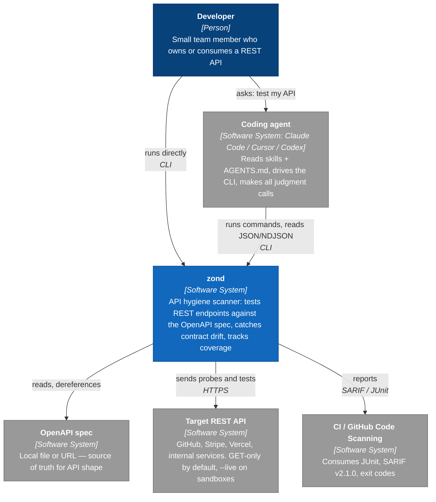
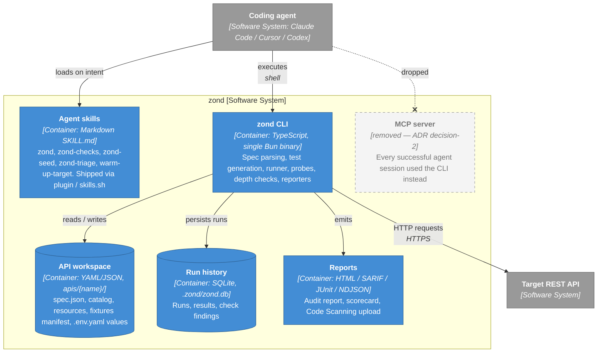
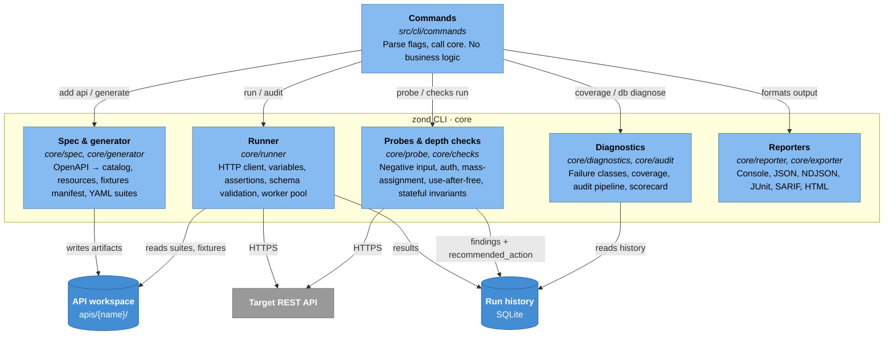

# Architecture (C4)

zond's architecture in the [C4 model](https://c4model.com): L1 Context → L2 Containers → L3 Components.
L4 (code) is the source itself — start at [`src/CLAUDE.md`](../src/CLAUDE.md).

Core principle ([decision-9](../backlog/decisions/decision-9%20-%20phase-transition-lighten-zond-agent-owns-judgment.md)):
**zond is a deterministic tool, the agent owns judgment.** zond sends requests, validates
schemas and emits evidence with closed-enum hints; severity, false-positive triage and
blame attribution stay with the agent. zond never calls an LLM.

## L1 — System Context

## L2 — Containers

zond ships as one self-contained binary (Bun-compiled); everything else is plain files
in the workspace. No daemon, no server, no transport layer.

The dashed **MCP server** was removed on purpose: every successful agent session used the CLI, so MCP
was dropped and stays dropped ([decision-2](../backlog/decisions/decision-2%20-%20Drop-MCP-server-—-keep-CLI-agent-skills-as-the-only-integration-surface.md),
reconfirmed in [decision-10](../backlog/decisions/decision-10%20-%20Подтверждение-decision-2-MCP-обёртку-не-возвращаем-даже-как-discovery-канал.md)).

## L3 — Components of the zond CLI

